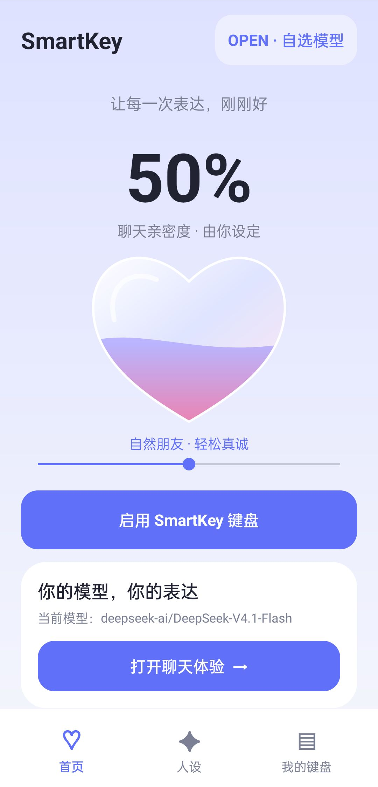
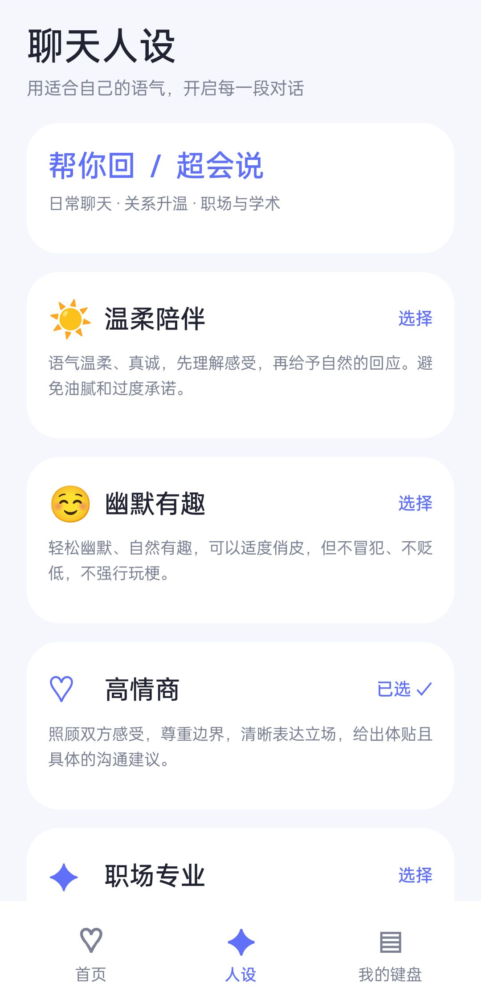
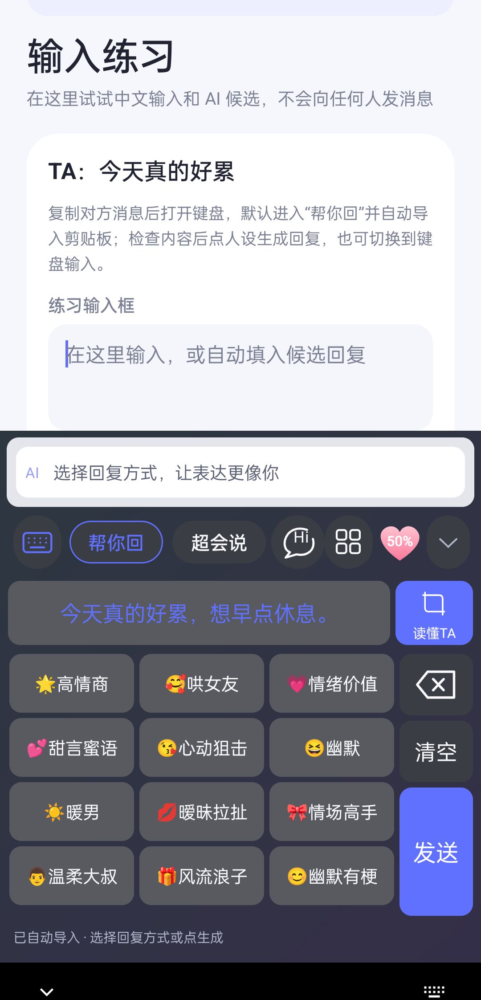
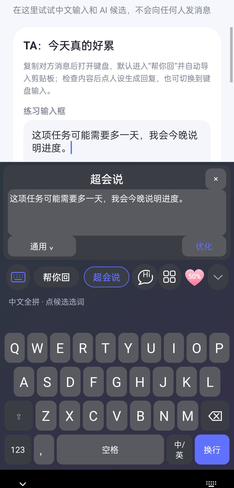
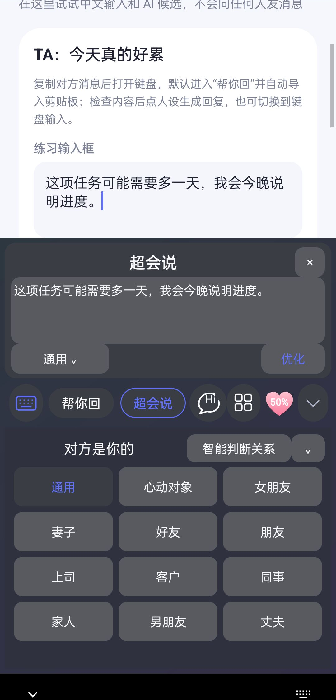

# SmartKey

面向Android通用输入框的AI沟通输入法，支持用户自行选择模型、服务地址和API Key。当前版本0.1.7。

## 功能

- 离线中文全拼、中英数字符号输入。
- 19种回复人设、11类开场白、12种关系润色。
- 打开键盘自动导入当前剪贴板；生成后自动填入第一条，选择其它候选替换本次草稿。
- 键盘内最多3张截图的本地中文OCR、文字预览和沟通分析。
- OpenAI兼容、Anthropic、Gemini、Ollama接口；自动获取、搜索和选择模型。
- AndroidKeyStore加密模型凭证和手动联系人记忆，自定义Prompt与本地主题。

没有会员、购买或付费解锁。只有用户点击发送才请求宿主发送；分析结果不会自动填入聊天。

## 界面预览

截图使用合成示例，不包含真实聊天、联系人或密钥。

<table>
  <tr>
    <td align="center">首页<br></td>
    <td align="center">人设<br></td>
    <td align="center">帮你回<br></td>
  </tr>
  <tr>
    <td align="center">超会说<br></td>
    <td align="center">关系选择<br></td>
  </tr>
</table>

## 构建

需要Windows PowerShell、JDK17或以上（建议JDK21）及首次下载依赖时的网络：

```powershell
powershell -NoProfile -ExecutionPolicy Bypass -File tools/setup.ps1
powershell -NoProfile -ExecutionPolicy Bypass -File tools/build.ps1 :app:assembleDebug :app:testDebugUnitTest
```

项目根目录是Gradle根目录，模块为android/app，输出APK为android/app/build/outputs/apk/debug/app-debug.apk。详细环境见[开发说明](docs/development.md)。支持Android8.0及以上；下载构建的安装包请使用仓库Releases。

安装后在系统设置启用SmartKey，填写模型服务地址/API Key并选择模型。复制需要回复的文字后打开键盘、选择人设即可生成。多条聊天可使用读懂TA选择截图，检查识别结果后分析或回复。本地试用页发送只清空练习输入框，不联系他人。

## 测试

```powershell
powershell -NoProfile -ExecutionPolicy Bypass -File tools/build.ps1 :app:testDebugUnitTest :app:assembleDebugAndroidTest
```

当前42项JVM测试通过，覆盖接口、模型目录、输入会话、草稿保护和取消阻塞请求。手机测试需要自行配置设备与合成素材；真实模型基准需显式开启。见[测试指南](docs/validation/android-tests.md)和[验证范围](docs/validation/acceptance.md)。

## 隐私与边界

键盘只能读取宿主提供的编辑框内容，不能自动读取完整聊天记录。剪贴板和选定截图作为用户提供的上下文；图片在手机本地识别，生成/分析时将相关文字发送到用户配置的模型服务。OCR可能误识别，需要检查预览。密码输入不启用AI，不持久化普通输入历史。

模型请求使用完整响应并校验三个候选后展示；服务端速度会波动。当前DeepSeek V4在已验证服务上关闭隐藏思考，取消会终止网络连接。语音、九宫格、iOS和端侧模型尚未实现。

应用ID/命名空间dev.lovekey.open及原输入法组件作为升级兼容标识保留，实际服务实现为SmartKeyImeService。

[数据处理说明](PRIVACY.md) · [安全说明](SECURITY.md) · [架构](docs/architecture.md) · [第三方来源](THIRD_PARTY.md)

源码发布不包含本机配置、私人截图、历史归档、日志、APK或签名文件。第三方来源和许可证保留；根目录未另行指定项目整体许可证。

## 准备公开源码

```powershell
python tools/prepare_public_source.py
```

输出为.github-ready/SmartKey及源码压缩包。仅包含显式允许的源码、公共文档、许可证和已检查演示图；不上传内容、不复制本机历史资料。不要直接拖拽整个开发工作目录上传。
